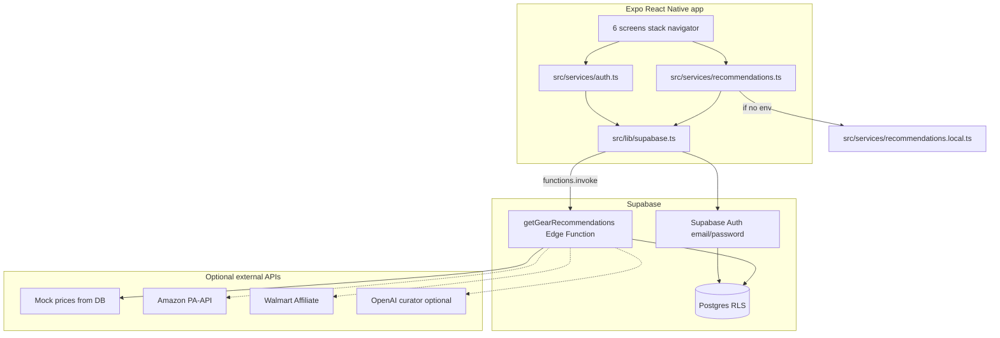

# BaitMate — Interview-ready codebase guide

Use this document to study the project and explain it in internship interviews. It matches the current repo layout and call flow.

## One-sentence pitch

**BaitMate is a React Native (Expo) app that walks anglers through species, method, and gear they already own, then fetches curated fishing gear recommendations with prices from a Supabase backend (Postgres + Edge Function), with offline fallback and pluggable retailer pricing.**

---

## High-level architecture



**Interview line:** The mobile app never talks to Amazon or Walmart directly. It calls one Edge Function; secrets stay server-side; pricing is swappable via a `PriceProvider` interface on the backend.

---

## 1. Screen flow and navigation params

Types are declared in [`App.tsx`](App.tsx) as `RootStackParamList`. Several screens also accept extra params at runtime (e.g. `species` vs `selectedSpecies` on the recommendation screen).

### Step-by-step trace

| Step | Screen | File | Params in | Params out (navigate) |
|------|--------|------|-----------|------------------------|
| 1 | Welcome | [`src/screens/WelcomeScreen.tsx`](src/screens/WelcomeScreen.tsx) | — | `SpeciesSelector` (no params) after login, signup, or guest |
| 2 | Species selector | [`src/screens/SpeciesSelectorScreen.tsx`](src/screens/SpeciesSelectorScreen.tsx) | — | `GearOwnership` with `{ selectedSpecies: Species }` where `Species.id` is the slug (e.g. `largemouth-bass`) |
| 3 | Gear ownership | [`src/screens/GearOwnershipScreen.tsx`](src/screens/GearOwnershipScreen.tsx) | `selectedSpecies` | If user **has gear**: `OwnedGearSelection` with `{ selectedSpecies }`. If **no gear**: `MethodQuestion` with `{ selectedSpecies, hasGear: false }` |
| 4a | Owned gear (optional) | [`src/screens/OwnedGearSelectionScreen.tsx`](src/screens/OwnedGearSelectionScreen.tsx) | `selectedSpecies` | `MethodQuestion` with `{ selectedSpecies, hasGear: true, ownedGroups: string[] }` — group **display names** like `"Rod"`, `"Reel"` |
| 4b | Method questions | [`src/screens/MethodQuestionScreen.tsx`](src/screens/MethodQuestionScreen.tsx) | `selectedSpecies`, `hasGear`, optional `ownedGroups` | `GearRecommendation` with `{ species: selectedSpecies, method: answers.location, gearOwned: ownedGroups or hasGear }` |
| 5 | Recommendations | [`src/screens/GearRecommendationScreen.tsx`](src/screens/GearRecommendationScreen.tsx) | See normalization below | `Welcome` via “Start Over” |

### What the recommendation screen sends to the API

[`GearRecommendationScreen.tsx`](src/screens/GearRecommendationScreen.tsx) normalizes route params, then calls [`fetchGearRecommendations`](src/services/recommendations.ts):

```ts
fetchGearRecommendations({
  species: speciesNorm.slug,      // from species.id or slug string
  method: methodNorm.slug,        // e.g. shore, wading, boat
  ownedGroups: ownedGroupsParam,  // slugs or display names; backend/local filter both
  budgetTier,                     // 'Best Value' | 'Premium'
});
```

**Normalization details (good to mention in interviews):**

- **Species:** `normalizeSpecies` accepts a string slug or an object with `id` / `name` (from `Species` in the selector).
- **Method:** `normalizeMethod` accepts a slug (`shore`) or object with `id` / `text`. `MethodQuestionScreen` passes `answers.location` from the first quiz question (option ids: `shore`, `wading`, `boat`).
- **Owned gear:** `normalizeOwnedGroups` only keeps string arrays; `true`/`false` from `hasGear` alone does not exclude groups (empty array = nothing owned).

### Auth on the welcome screen

[`src/services/auth.ts`](src/services/auth.ts) wraps Supabase Auth:

- `signInWithEmail` / `signUpWithEmail` — email normalized to lowercase; passwords are **hashed by Supabase**, not stored in your Postgres tables.
- Duplicate emails are rejected at signup with a friendly message.
- Guest path skips auth and goes straight to `SpeciesSelector`.

---

## 2. Mobile service layer

| File | Role |
|------|------|
| [`src/lib/supabase.ts`](src/lib/supabase.ts) | Lazy client; `EXPO_PUBLIC_SUPABASE_URL` + `EXPO_PUBLIC_SUPABASE_ANON_KEY`; AsyncStorage for sessions |
| [`src/services/recommendations.ts`](src/services/recommendations.ts) | **Single entry** for gear API: `supabase.functions.invoke('getGearRecommendations')` or offline fallback |
| [`src/services/recommendations.local.ts`](src/services/recommendations.local.ts) | In-memory catalog from [`src/services/seedData.ts`](src/services/seedData.ts) when env is missing |
| [`src/types/recommendations.ts`](src/types/recommendations.ts) | Request/response types and `RecommendationErrorBody` codes |

**Interview line:** Screens stay thin; network and auth live in services so Vitest can test recommendation logic without React.

### Client tests

```bash
npm test          # Vitest: recommendations.local + service fallback
npm run typecheck
```

- [`tests/recommendations.local.test.ts`](tests/recommendations.local.test.ts) — tier selection, owned-group filtering, totals.
- [`tests/recommendations.service.test.ts`](tests/recommendations.service.test.ts) — mocks unconfigured Supabase → local path.

---

## 3. Backend: Edge Function pipeline

Entry: [`supabase/functions/getGearRecommendations/index.ts`](supabase/functions/getGearRecommendations/index.ts)

Execute in this order when explaining interviews:

1. **CORS / POST only** — `OPTIONS` returns 204; invalid method → 405.
2. **Validate** — Zod in [`supabase/functions/_shared/validation.ts`](supabase/functions/_shared/validation.ts): `species`, `method`, `ownedGroups[]`, `budgetTier`.
3. **Env** — `SUPABASE_URL` + `SUPABASE_SERVICE_ROLE_KEY` (service role bypasses RLS for cache writes).
4. **Cache read** — [`cache.ts`](supabase/functions/_shared/cache.ts): SHA-256 hash of `species|method|sorted(ownedGroups)|budgetTier|PRICE_PROVIDER`; TTL 24h; hit sets `source.cached: true`.
5. **Resolve slugs** — [`repository.ts`](supabase/functions/_shared/repository.ts): species/method UUIDs; 404 if unknown.
6. **Catalog query** — `species_method_gear` joined to items/groups; exclude rows whose group slug is in `ownedGroups`.
7. **Optional curator** — [`curator.ts`](supabase/functions/_shared/curator.ts) when `LLM_CURATOR=on` and `OPENAI_API_KEY` set; returns rationales + search hints; **on failure returns null** (fail-open).
8. **Pricing** — [`priceProviders/index.ts`](supabase/functions/_shared/priceProviders/index.ts):
   - `mock` — [`mock.ts`](supabase/functions/_shared/priceProviders/mock.ts) reads `price_results` for retailer `mock`.
   - `amazon` / `walmart` — live search with SigV4 / RSA ([`amazon.ts`](supabase/functions/_shared/priceProviders/amazon.ts), [`walmart.ts`](supabase/functions/_shared/priceProviders/walmart.ts)); need affiliate credentials.
   - `hybrid` — [`hybrid.ts`](supabase/functions/_shared/priceProviders/hybrid.ts) merges enabled retailers; Edge Function **falls back to mock** if primary returns no prices.
9. **Tier selection** — Per gear group, pick item matching `budgetTier` (with tag substitutes).
10. **Cheapest price** — Among `PriceResult[]` for each item (hybrid may return multiple retailers).
11. **Cache write** + structured log line — [`logger.ts`](supabase/functions/_shared/logger.ts).

### Postgres schema

[`supabase/migrations/20260427000001_init_schema.sql`](supabase/migrations/20260427000001_init_schema.sql)

| Table | Purpose |
|-------|---------|
| `species`, `fishing_methods`, `gear_groups` | Lookup |
| `gear_items` | Catalog rows (name, tag, base price) |
| `species_method_gear` | Which items apply to which species + method |
| `retailers`, `price_results` | Mock (and future live) offer snapshots |
| `cached_recommendations` | Full JSON responses by hash |

Seed data: [`supabase/seed.sql`](supabase/seed.sql) — rebuilds catalog + mock prices.

### Backend tests

```bash
npm run test:edge   # requires Deno: validation, mock provider, search queries
```

---

## 4. Tradeoffs and honesty (what to say in interviews)

| Topic | Current behavior | How to phrase it |
|-------|------------------|------------------|
| **Mock vs live pricing** | `PRICE_PROVIDER=mock` default; Amazon/Walmart need keys | “Provider pattern with mock fallback so demos and outages don’t break the UI.” |
| **Offline / no `.env`** | `fetchGearRecommendations` → `buildLocalRecommendation` | “Same function signature whether or not Supabase is configured—good for reviewers and Expo Go without secrets.” |
| **Auth** | Supabase Auth; unique email enforced by platform | “No custom password column; I use the platform’s hashed credentials.” |
| **RLS** | Anon `SELECT` on catalog; cache service-role only | “Public read for catalog; privileged writes only from the Edge Function.” |
| **`verify_jwt`** | `false` in [`supabase/config.toml`](supabase/config.toml) for `getGearRecommendations` | “Known follow-up: lock the function to signed-in users before a public launch.” |
| **LLM curator** | Off by default; fail-open | “Feature-flagged enhancement, not required for core flow.” |
| **Method quiz** | Three questions; only `location` id is sent as `method` to the API today | “UI collects more context; backend keys recommendations on species + method slug for now.” |

### Sample answers

**Tell me about the project.**  
Mobile app for personalized fishing gear. React Native + TypeScript on the client; Supabase for auth, Postgres catalog, and a Deno Edge Function that assembles recommendations and prices. I used a provider pattern so mock, Amazon, and Walmart can be swapped without changing the app.

**Hardest technical decision?**  
Keeping the app working without a backend via a local recommendation builder that mirrors seeded data, while still having one code path (`fetchGearRecommendations`) for the real API.

**How do you handle failures?**  
Zod validation and structured error codes on the server; typed `RecommendationServiceError` on the client; mock fallback for pricing; curator and retailer adapters fail open so one outage does not break the screen.

**Security?**  
Service role and retailer keys only in Edge secrets; anon RLS read-only on catalog; passwords via Supabase Auth. Follow-up: enable JWT on the Edge Function before public launch.

---

## 5. Study checklist (2–3 hours)

- [ ] Read [`App.tsx`](App.tsx) and trace the table in **Section 1** out loud.
- [ ] Open [`GearRecommendationScreen.tsx`](src/screens/GearRecommendationScreen.tsx) and follow `loadRecommendations` → [`recommendations.ts`](src/services/recommendations.ts).
- [ ] Walk **Section 3** pipeline in [`getGearRecommendations/index.ts`](supabase/functions/getGearRecommendations/index.ts).
- [ ] Skim [`mock.ts`](supabase/functions/_shared/priceProviders/mock.ts) and [`supabase/seed.sql`](supabase/seed.sql).
- [ ] Read [`auth.ts`](src/services/auth.ts) and Welcome submit handler.
- [ ] Run `npm test` and explain one assertion from [`recommendations.local.test.ts`](tests/recommendations.local.test.ts).
- [ ] Practice a 2-minute verbal walkthrough twice.

---

## 6. Local development (quick reference)

```bash
npm install
cp .env.example .env   # fill EXPO_PUBLIC_SUPABASE_URL and EXPO_PUBLIC_SUPABASE_ANON_KEY
npm start              # or npm run ios / npm run ios:sim
```

Supabase (optional, for real backend):

```bash
supabase start
supabase db reset      # migration + seed
supabase functions serve getGearRecommendations --no-verify-jwt
```

See [`.env.example`](.env.example) for `PRICE_PROVIDER`, retailer keys, and `LLM_CURATOR`.
