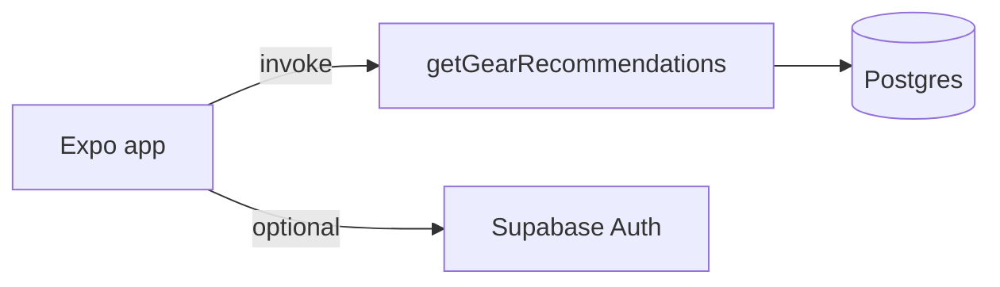

# BaitMate

**New to this codebase? Start with [the codebase guide](docs/CODEBASE_GUIDE.md)**
for the current user flow, authentication/session lifecycle, recommendation
fallbacks, kit trial, setup, limitations, and where to change each feature.

BaitMate is a mobile app (Expo / React Native) that helps anglers get personalized fishing gear recommendations: pick a species, say what you already own, choose how you fish, and see curated gear with prices and buy links.

## Architecture (short)

- **App:** Stack navigator (`Welcome` → species → gear ownership → budget → access popup → recommendations). Business logic in [`src/services/`](src/services/) (auth + recommendations).
- **Backend:** Supabase Postgres (catalog + mock prices + response cache) and one Edge Function, `getGearRecommendations`, with pluggable price providers (mock / Amazon / Walmart / hybrid).
- **Offline:** If Supabase env vars are missing, the app uses the same API shape via an in-memory mirror of seed data.



**Full interview walkthrough, screen-by-screen params, and talking points:** see **[INTERVIEW.md](INTERVIEW.md)**.

## What's implemented vs planned

| Area | Status |
|------|--------|
| Email/password forms, session restoration, guest mode | Implemented; successful live login still needs verification |
| Recommendations via Edge Function + mock prices | Requires backend deployment; local fallback available |
| Offline demo without Supabase | Working |
| Caching, validation, structured logging | Working |
| Amazon / Walmart live pricing | Needs affiliate API keys in production |
| LLM curator | Optional (`LLM_CURATOR=on`) |

## Development

```bash
npm install
# Create a local .env with EXPO_PUBLIC_SUPABASE_URL and EXPO_PUBLIC_SUPABASE_ANON_KEY
npm start
npm run ios            # requires Xcode Simulator or device
npm run ios:sim        # opens Simulator first, then Expo iOS
```

### Michigan fishing map

The discovery map uses Mapbox on iOS, Android, and web. Add a client-side
Mapbox public token to `.env`:

```bash
EXPO_PUBLIC_MAPBOX_ACCESS_TOKEN=pk.your_public_token
```

Because `@rnmapbox/maps` includes custom native code, test the native map with
a development build (`npx expo run:ios` or `npx expo run:android`) rather than
Expo Go. The web build works through Mapbox GL JS.

```bash
npm run typecheck
npm test
npm run test:edge      # Deno tests for Edge Function helpers
```

### Supabase (local backend)

```bash
supabase start
supabase db reset
supabase functions serve getGearRecommendations --no-verify-jwt
```

Set server-only Edge secrets (such as `SUPABASE_SERVICE_ROLE_KEY` and
`PRICE_PROVIDER=mock`) in Supabase separately from the client settings in your
local `.env`. Never commit `.env` or service role keys.

## Project layout

| Path | Purpose |
|------|---------|
| `App.tsx` | Navigation + shared types |
| `src/screens/` | UI screens |
| `src/services/` | Auth and recommendations |
| `src/lib/supabase.ts` | Supabase client |
| `supabase/migrations/` | Postgres schema |
| `supabase/seed.sql` | Catalog + mock prices |
| `supabase/functions/` | Edge Function + shared modules |
| `tests/` | Vitest (app) |
| `INTERVIEW.md` | Codebase guide for interviews |

## License

Private project — update as needed for your portfolio.

## Beginner gear budgets

The guest flow is species → owned gear → budget → species access popup → recommendations.
Enter a USD target (including $0) or use the starter catalog estimate. Numeric-budget
requests choose the lowest-priced item in every unowned catalog category rather than
spending up to the target. Existing callers without a budget retain tier selection.

Results distinguish costs at/below the target, up to 15% above it, and an unaffordable
starter savings goal. The 15% ceiling is rounded down to whole cents. Required catalog
categories are never removed just to make a total fit. Ownership switches update the
remaining cost and budget status. Estimates exclude taxes, shipping, licenses, and
boat/wading equipment; retailer search links are not guaranteed live prices.

The local demo and Supabase function use the same lowest-cost selection and budget
validation policy. Deploy the updated `getGearRecommendations` Edge Function before
using the feature with an existing hosted backend. Cache keys include the budget.
The current seed catalog may lack inexpensive starter options for some species; an
over-budget result describes this catalog, not the minimum possible cost of fishing.
