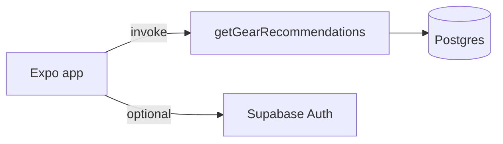

# BaitMate

BaitMate is a mobile app (Expo / React Native) that helps anglers get personalized fishing gear recommendations: pick a species, say what you already own, choose how you fish, and see curated gear with prices and buy links.

## Architecture (short)

- **App:** Stack navigator (`Welcome` → species → gear ownership → method → recommendations). Business logic in [`src/services/`](src/services/) (auth + recommendations).
- **Backend:** Supabase Postgres (catalog + mock prices + response cache) and one Edge Function, `getGearRecommendations`, with pluggable price providers (mock / Amazon / Walmart / hybrid).
- **Offline:** If Supabase env vars are missing, the app uses the same API shape via an in-memory mirror of seed data.



**Full interview walkthrough, screen-by-screen params, and talking points:** see **[INTERVIEW.md](INTERVIEW.md)**.

## What's implemented vs planned

| Area | Status |
|------|--------|
| UI flow, auth (email/password), guest mode | Working |
| Recommendations via Edge Function + mock prices | Working |
| Offline demo without Supabase | Working |
| Caching, validation, structured logging | Working |
| Amazon / Walmart live pricing | Needs affiliate API keys in production |
| LLM curator | Optional (`LLM_CURATOR=on`) |

## Development

```bash
npm install
cp .env.example .env   # EXPO_PUBLIC_SUPABASE_URL, EXPO_PUBLIC_SUPABASE_ANON_KEY
npm start
npm run ios            # requires Xcode Simulator or device
npm run ios:sim        # opens Simulator first, then Expo iOS
```

```bash
npm run typecheck
npm test
npm run test:edge      # Deno tests for Edge Function helpers
```

### Supabase (local backend)

```bash
supabase start
supabase db reset
supabase functions serve getGearRecommendations --no-verify-jwt
```

Set Edge secrets (`SUPABASE_SERVICE_ROLE_KEY`, `PRICE_PROVIDER=mock`, etc.) per [`.env.example`](.env.example). Never commit `.env` or service role keys.

## Project layout

| Path | Purpose |
|------|---------|
| `App.tsx` | Navigation + shared types |
| `src/screens/` | UI screens |
| `src/services/` | Auth and recommendations |
| `src/lib/supabase.ts` | Supabase client |
| `supabase/migrations/` | Postgres schema |
| `supabase/seed.sql` | Catalog + mock prices |
| `supabase/functions/` | Edge Function + shared modules |
| `tests/` | Vitest (app) |
| `INTERVIEW.md` | Codebase guide for interviews |

## License

Private project — update as needed for your portfolio.
