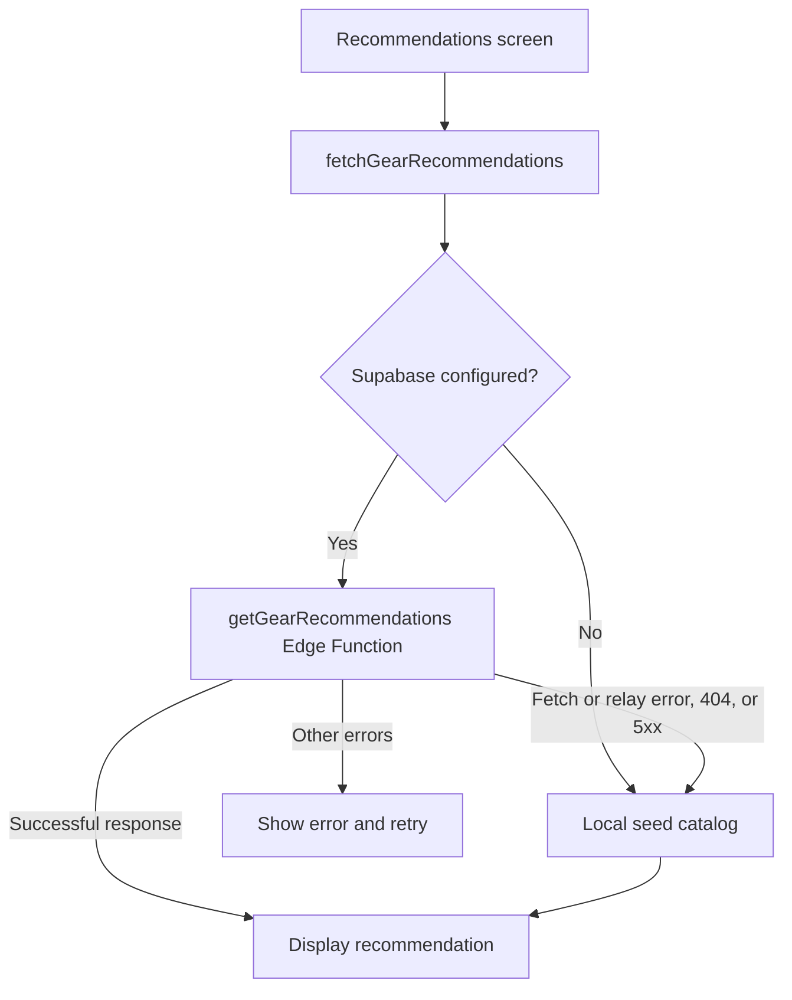

# Understanding BaitMate

This guide explains the current code, including its limitations. Start with
`App.tsx`, then follow the screen or service linked to the feature you want to change.

## The user journey

1. `WelcomeScreen.tsx` provides email/password login, registration, password-reset
   requests, and guest access. The Sign up tab changes the form; Create account submits it.
2. `SpeciesSelectorScreen.tsx` selects the target fish.
3. `GearOwnershipScreen.tsx` asks about existing gear;
   `OwnedGearSelectionScreen.tsx` records owned categories.
4. `BudgetScreen.tsx` collects a dollar target and opens a species-specific access
   popup. Shore/dock is the beginner default. Salmon, trout, and steelhead also
   offer wading, with an explicit wader-ownership question.
5. `GearRecommendationScreen.tsx` requests recommendations, displays remaining
   estimated costs, links to retailers, and lets users mark recommended items owned.
6. `FishingMapScreen.tsx` is reachable independently; `AccountScreen.tsx` shows
   account information and provides sign-out.

`MethodQuestionScreen.tsx` is an older route retained in the navigator. The main
budget flow now bypasses it. The progress component still has a Method label;
it has not yet been redesigned to match the popup flow.

Navigation parameter types live in `App.tsx`. Parameters pass the selected species,
owned categories, method, and budget between screens. This is not a saved user profile.

## Authentication: who does what?

- `src/lib/supabase.ts` creates one reusable Supabase client from Expo environment
  settings. Without those settings it returns null; guest recommendations still work.
- `src/services/auth.ts` normalizes email addresses, submits credentials to Supabase,
  and translates common server errors into readable messages.
- `WelcomeScreen.tsx` validates the form and displays feedback inline. This matters
  because React Native Web's native Alert implementation does not show these dialogs.
- `App.tsx` restores the stored session on startup and subscribes to authentication
  changes. Changing between signed-in and guest sessions remounts the navigator,
  resetting its navigation history.
- `AccountScreen.tsx` loads the current user and signs out of this device.

Supabase owns account records and password hashing. BaitMate does not store a
plain-text password or implement HomeworkTracker's custom session-cookie system.
The SDK persists session tokens in AsyncStorage and refreshes them automatically.
AsyncStorage is not an encrypted credential vault. Do not describe this as secure
password storage or add raw passwords to it. A future native security upgrade can
use platform secure storage with a Supabase-compatible storage adapter.

Duplicate email prevention belongs to Supabase Auth, not a client-side lookup.
Duplicate signup responses may intentionally conceal whether an account exists.
Do not add a publicly readable users table to check registration availability.

Email confirmation is controlled by the hosted project's Auth settings. A signup
can succeed without a session, in which case the user must confirm their email.
Password-reset email requests exist, but the app does not yet implement a complete
recovery callback/new-password screen. Guest access remains intentional: this app
does not protect all screens behind login. Protect future private data with RLS.

## How gear recommendations work



`src/types/recommendations.ts` defines the request/response contract shared by the
UI and app services. The Edge Function has its own types under `_shared`.

`recommendations.local.ts` selects from `seedData.ts`. When a numeric budget is
provided it picks the cheapest entry in each unowned category. It does not invent
cheaper products or remove categories to force a fit. Without a numeric budget,
the requested quality tier is used. The local engine does not currently vary
catalog contents by shore versus wading method.

`supabase/functions/_shared/budget.ts` validates money and calculates status using
cents. Individual gear estimates may be within target, within the 15% stretch
limit, or above it. That stretch rule is separate from the kit trial's strict
below-budget filter. Taxes, shipping, licenses, and waders are not included.

Retailer search links are not verified product offers. Local prices are catalog
estimates; the fallback reports provider `mock`. Connecting Supabase Auth does
not deploy the recommendations function or populate the catalog database.

### Packaged-kit trial

`src/components/BudgetKitTrial.tsx` adds an independent recommendation card.
It currently contains one manually researched bass kit, matched to largemouth
and smallmouth bass. Its price was checked October 18, 2026; it is not refreshed
automatically and stock is not guaranteed. Other species explicitly report that
no verified kit is available in this trial catalog.

The filter compares integer cents and requires the kit price to be strictly below
the target. It does not claim the delivered price fits after tax/shipping. A kit
is an alternative to the individual list, not part of its total. Owned gear is
not subtracted from a packaged kit's price.

The card's switch hides the trial on that mounted screen. To remove the experiment
from code, remove the component import and its two render sites in
`GearRecommendationScreen.tsx`. Keep the existing individual recommendation logic.

## Maps and fishing access

`FishingMapScreen.tsx` integrates Mapbox. The public token comes from `.env`.
`src/data/michiganFishingSpots.ts` holds curated spot data; this is not a live
fish-location prediction service. `src/lib/appleMaps.ts` builds destination links.
Coordinate selection does not guarantee legal public access or safe conditions.
Native Mapbox needs a development build rather than Expo Go.

## Where to make changes

| Change | Start here |
| --- | --- |
| Colors and shared visual styling | `src/theme.ts` |
| Screens and navigation parameters | `App.tsx`, `src/screens/` |
| Login messages and request handling | `WelcomeScreen.tsx`, `services/auth.ts` |
| Catalog products or estimates | `services/seedData.ts`, `supabase/seed.sql` |
| Selection and fallback behavior | `services/recommendations.local.ts`, `services/recommendations.ts` |
| Budget policy | `supabase/functions/_shared/budget.ts` |
| Packaged kits | `components/BudgetKitTrial.tsx` |
| Backend schema | `supabase/migrations/` |
| Retailer integrations | `supabase/functions/_shared/priceProviders/` |

Keep local seed data and database seed data aligned. Changes to backend helpers
need deployment before the hosted function uses them. Never edit an applied
migration to change production state; add a new migration.

## Setup and verification

1. Install dependencies with `npm install`.
2. For a fresh checkout, create a local `.env`. Do not overwrite an existing
   configured `.env`.
3. Fill `EXPO_PUBLIC_SUPABASE_URL` and `EXPO_PUBLIC_SUPABASE_ANON_KEY` (a public
   publishable key also works in this setting). Add `EXPO_PUBLIC_MAPBOX_ACCESS_TOKEN`
   for maps. All `EXPO_PUBLIC_` values are bundled into the app: never put secret
   or service-role keys there. `.env` and `.env.example` stay ignored by Git.
4. Start web with `npm run web -- --clear` after environment changes.
5. Configure Supabase Auth site/redirect URLs for the actual app URL. The local
   CLI config is not proof that hosted dashboard settings match.
6. For cloud gear results, apply migrations/seed data and deploy
   `getGearRecommendations` separately. Server secrets belong in Supabase, not Expo.

Useful checks:

```bash
npm run typecheck
npm test
npm run test:edge  # requires Deno
```

Vitest covers budgets, local recommendations, service fallback, retailer links,
and Apple Maps helpers. Passing these checks does not prove a real account can
log in, that email is delivered, or that Mapbox renders correctly.

Manual smoke test: register with a test email, confirm the email, log in, reload
to check restoration, sign out, and try an incorrect password. For gear, compare
bass at $100 and a very small budget, mark gear owned, toggle the kit trial, and
verify retailer links. Do not paste personal passwords into logs or test fixtures.

## Current data-persistence boundary

Sessions persist, but gear ownership, selected species, budgets, and the kit toggle
are currently screen/navigation state. They are not automatically saved to a user
account across devices. Account-specific saved plans require a new database model,
ownership policies, and explicit loading/saving code.
